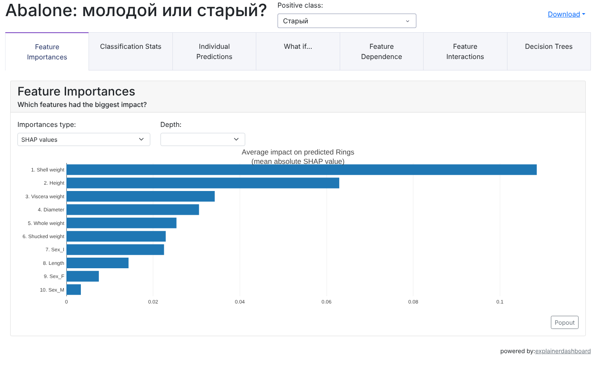

# Abalone: определение возраста морского ушка по физическим измерениям

Возраст абалона (морского ушка) обычно определяют долго и трудоемко: раковину распиливают, окрашивают и считают кольца под микроскопом. В проекте модель по простым измерениям (размеры и вес) определяет, молодая особь или старая. Есть полный путь от EDA до интерактивного дашборда в Docker-контейнере.


🔗 **[Открыть дашборд](https://anastasiien.github.io/Abalone-analysis/)** · 📓 [EDA](https://nbviewer.org/github/Anastasiien/Abalone-analysis/blob/main/notebooks/01_eda.ipynb) · 📓 [Модели](https://nbviewer.org/github/Anastasiien/Abalone-analysis/blob/main/notebooks/02_models.ipynb)



## Результаты

Задача: бинарная классификация, «старый» абалон - это больше 9 колец (медиана). При таком пороге классы сбалансированы: 2096 и 2081.

| Модель | Признаки | Accuracy |
|---|---|---|
| Наивный Байес (GaussianNB) | числовые | 0.730 |
| kNN, параметры по умолчанию | числовые | 0.770 |
| **kNN + GridSearchCV** (k=12, веса по расстоянию) | числовые | **0.786** |
| kNN + GridSearchCV | числовые + пол | 0.778 |

- Лучшая модель - kNN с подобранными гиперпараметрами: верно определяет возраст в 79% случаев.
- Добавление пола качество не улучшило. Информация о поле, видимо, уже содержится в размерах: ANOVA в EDA показала сильную связь пола со всеми измерениями.
- Главный признак по SHAP и permutation importance - **вес сухой раковины** (Shell weight), за ним вес мяса и общий вес. Логично: раковина растет вместе с особью, и ее вес накапливается с возрастом.

## Что сделано

**1. EDA** ([01_eda.ipynb](notebooks/01_eda.ipynb))
- пропуски (2.4% в трех признаках) заполнены медианой, исправлена опечатка в категории пола (`f` → `F`)
- распределения признаков и целевой переменной, корреляции Пирсона, Спирмена и Кендалла
- V Крамера для категориального признака и ANOVA для связи пола с числовыми признаками
- сравнение скорости pandas и Polars на датасете, увеличенном до 1.2 млн строк

**2. Модели** ([02_models.ipynb](notebooks/02_models.ipynb))
- GaussianNB и kNN на числовых признаках, подбор гиперпараметров через GridSearchCV
- добавление категориального признака через `OneHotEncoder` + `ColumnTransformer`
- интерпретация: SHAP values, permutation importance, разбор отдельных прогнозов

**3. Дашборд и деплой** ([app/](app/))
- интерактивный дашборд на explainerdashboard: важность признаков, метрики, разбор прогнозов, режим «What if»
- модель для дашборда - Random Forest (accuracy 0.79, ROC-AUC 0.87): деревья позволяют быстро считать точные SHAP-значения
- дашборд упакован в Docker-контейнер и поднимается одной командой

## Запуск

Дашборд в Docker:

```bash
git clone https://github.com/Anastasiien/Abalone-analysis.git
cd Abalone-analysis/app
docker build -t abalone-dashboard .
docker run -p 9050:9050 abalone-dashboard
```

Потом открыть http://localhost:9050

Ноутбуки:

```bash
pip install -r requirements.txt
jupyter notebook notebooks/
```

## Структура

```
├── notebooks/
│   ├── 01_eda.ipynb          # разведочный анализ
│   └── 02_models.ipynb       # модели и интерпретация
├── app/
│   ├── dashboard.py          # обучение модели и сборка дашборда
│   ├── app.py                # запуск дашборда
│   ├── dataset.csv
│   ├── requirements.txt
│   └── Dockerfile
├── docs/
│   └── index.html            # статическая версия дашборда для GitHub Pages
├── images/
└── requirements.txt
```

## Данные

[abalone.csv](https://github.com/aiedu-courses/eda_and_dev_tools/blob/main/datasets/abalone.csv): 4177 особей, пол (M / F / I - детеныш), 7 физических измерений и число колец. Возраст = кольца + 1.5 года.

---

**Автор:** Анастасия Бердюгина, НИУ ВШЭ Нижний Новгород
